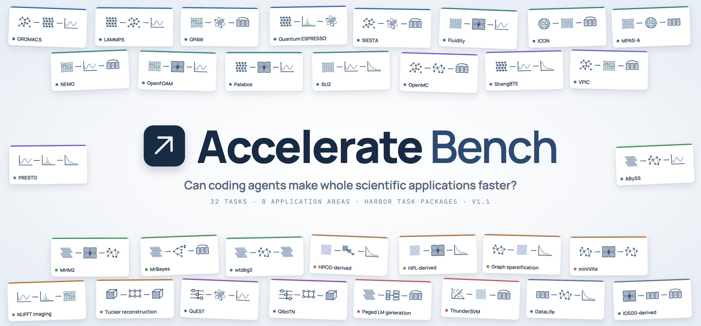
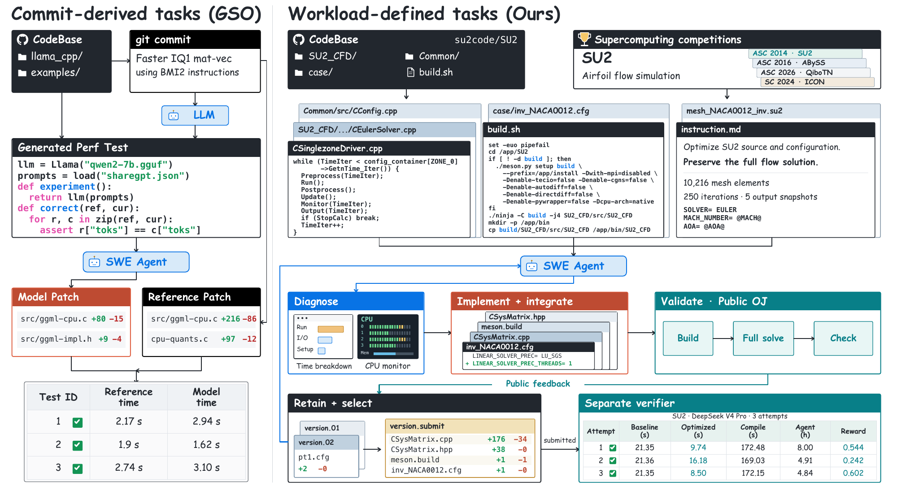

<div align="center">

<p align="center">
  
</p>

</div>

A long-horizon coding agent benchmark for speeding up scientific applications

Accelerate Bench has 32 CPU tasks adapted from scientific applications and six supercomputing competitions. Each gives a coding agent a working program, a fixed workload and rules on what it may change. Within an eight-hour budget, the agent can measure where time goes, change code, build or runtime settings, and test candidates with public tests. A hidden verifier then checks the final program on private inputs and times the end-to-end workflow. On version 1.1, most programs from 16 coding agents stayed correct; what separated the agents was how much faster they made the applications.

[Website](https://acceleratebench.com/) · [Paper (arXiv)](https://arxiv.org/abs/2611.20882) · [Hugging Face dataset](https://huggingface.co/datasets/AdAstraAbyssoque/accelerate-bench) · [Harbor Hub](https://hub.harborframework.com/datasets/accelerate-bench/accelerate-bench)

## Key findings

- **Correctness alone does not separate the agents; speed does.** On v1.1, each of the 16 agents was correct on 26 to 32 of the 32 tasks, yet Score@1 ranged from 25.5% to 67.4%. GPT-6.1 Terra with Codex was correct on all 32 tasks and scored 37.9%; Kimi K3 with Claude Code was correct on 28 and scored 42.5%. (§4, Table 1)
- **The two leading agents reach large speedups far more often.** Claude Sonnet 5.5 and Claude Opus 5.5, both with Claude Code, were at least 2× faster on 22 or more of the 32 tasks. The other fourteen agents reached 2× on 8 to 17 tasks, and 125 of their 412 correct programs were less than 1.25× faster than the baseline. (v1.1; §4, Fig. 3)
- **Build and runtime settings can change speed several-fold, yet the analyzed agents rarely tuned them.** In 476 labeled v1.0 runs from five agents, 225 changed how the computation is done, including reusing computed results, while compiler and build tuning appeared in only 40. Replaying the same GROMACS source code under four build and runtime settings gave correct results in all four, at 0.29× to 2.12× the speed of a fixed reference. (v1.0 analysis; §5, App. L.1)
- **What a code change is worth can depend on other changes.** In one QiboTN program, deferring the import of tensor libraries made it only 1.01× faster on its own, but 6.3–6.4× faster once another change sent more circuits to a fast exact simulator. (v1.0 analysis; §5, App. L.2)

<div align="center">

[](https://acceleratebench.com/#leaderboard) [](LICENSE)

<p align="center">
  
</p>

<sub>Commit-derived tasks (left, as in GSO) start from one known performance commit and measure the agent's patch against it. Accelerate Bench tasks (right) fix the workload and the computation that must be preserved; the agent decides where and how to optimize, and a separate verifier scores the final program.</sub>

</div>

Each task gives the agent a working application, such as GROMACS, OpenFOAM or Quantum ESPRESSO, with a fixed workload and a CPU and memory budget. The agent has eight hours to make the whole program faster; a separate private verifier then rebuilds the final program, checks it on hidden inputs and times it against the unmodified program.

- **32 tasks** from 8 application areas, adapted from scientific codes and supercomputing competitions
- **Harbor task packages**: each task is a directory with `task.toml`, `instruction.md`, `environment/` and `tests/`; 31 of them are on [Harbor Hub](https://hub.harborframework.com/datasets/accelerate-bench/accelerate-bench) and run with one `harbor run` command (see [Quickstart](#quickstart))
- **Score@1**: correctness-gated runtime savings averaged over the 32 tasks (see [Scoring](#scoring))
- **Version 1.1**, the version evaluated in the paper

## Leaderboard

Benchmark v1.1, one run per agent and task, with all final programs scored on the same machine (paper Table 1). Score@1 and A<sub>τ</sub> are percentages.

| # | Agent | Harness | Score@1 | GM | A<sub>1.25</sub> | A<sub>2</sub> |
|---:|---|---|---:|---:|---:|---:|
| 1 | Claude Sonnet 5.5 | Claude Code | 67.4 | 3.83× | 100.0 | 71.9 |
| 2 | Claude Opus 5.5<sup>†</sup> | Claude Code | 59.4 | 3.94× | 84.4 | 68.8 |
| 3 | GPT-6.1 Sol | Codex | 49.2 | 2.42× | 78.1 | 50.0 |
| 4 | GPT-6 Astra | Codex | 47.2 | 2.40× | 75.0 | 53.1 |
| 5 | Hy4-Preview | Claude Code | 45.2 | 2.31× | 71.9 | 50.0 |
| 6 | Hy4 | Claude Code | 45.0 | 2.41× | 75.0 | 46.9 |
| 7 | Kimi K3 | Claude Code | 42.5 | 2.47× | 68.8 | 40.6 |
| 8 | DeepSeek-V4.1-Flash-1017 | Claude Code | 40.1 | 2.28× | 65.6 | 34.4 |
| 9 | GLM-5.3 | Claude Code | 39.7 | 2.20× | 65.6 | 40.6 |
| 10 | GLM-5.3-Flash | Claude Code | 39.3 | 2.20× | 68.8 | 34.4 |
| 11 | DeepSeek-V4-Pro | Claude Code | 37.9 | 2.19× | 62.5 | 34.4 |
| 12 | GPT-6.1 Terra | Codex | 37.9 | 1.92× | 75.0 | 25.0 |
| 13 | DeepSeek-V4-Flash | Claude Code | 34.1 | 1.92× | 56.2 | 34.4 |
| 14 | GLM-5.2 | Claude Code | 34.0 | 1.98× | 46.9 | 37.5 |
| 15 | Grok 4.6 | Claude Code | 33.9 | 2.13× | 50.0 | 34.4 |
| 16 | Hy3 | Claude Code | 25.5 | 1.76× | 37.5 | 28.1 |

<sup>†</sup>The provider's safety system stopped the Claude Opus 5.5 runs on Graph sparsification, PRESTO and VPIC; they count as failures with zero reward. On its other 29 tasks, Claude Opus 5.5 scores 65.6%. Gemini-3.8-Flash is not listed because its v1.1 runs are not yet complete. Per-task results are in the [results JSON](https://acceleratebench.com/assets/results.json).

## Quickstart

You need Python 3.12 or later. Running tasks needs Linux x86-64 with Docker Engine and Docker Compose v2.

### Run from Harbor Hub

31 of the 32 tasks are published as the Harbor dataset [`accelerate-bench/accelerate-bench`](https://hub.harborframework.com/datasets/accelerate-bench/accelerate-bench). Harbor downloads them for you; no access request is needed:

```sh
pip install harbor==0.22.0
export ANTHROPIC_API_KEY=...
harbor run -d accelerate-bench/accelerate-bench@v1.1 \
  -a claude-code -m anthropic/MODEL_ID --ak reasoning_effort=high -n 1
```

`-n 1` runs one task at a time. Each task gives the agent 4 or 8 CPUs and up to 32 GiB of memory and runs a public-test service next to it, so raise `-n` only if the host has room for several tasks at once. Add `-i hpcg-multigrid-pcg` to run a single task. ICON is not on Harbor Hub because its two grid files have to be downloaded from their official source; the full release below includes it.

### Full release from Hugging Face

The full release has all 32 tasks in one archive, with a manifest of every file's SHA-256.

**1. Request access.** Open the [dataset page](https://huggingface.co/datasets/AdAstraAbyssoque/accelerate-bench), sign in and describe your institution and planned evaluation. Approval is manual. Evaluation, reproduction, auditing and teaching are supported; please do not train on the tasks or redistribute them.

**2. Download and verify the tasks** (about 2.56 GB):

```sh
git clone https://github.com/AdAstraAbyssoque/accelerate-bench
cd accelerate-bench
python3 -m venv .venv && . .venv/bin/activate
pip install -r requirements-download.txt
hf auth login
python scripts/download_data.py
```

The script downloads the archive pinned in `data-release.json`, checks its SHA-256 and every task file against `canonical/manifest.json`, and installs the tasks into `canonical/tasks/`. ICON needs two grid files from their official source:

```sh
python public-release/fetch_external_data.py --only icon-grid-0013 \
  --cache ./asset-cache --hydrate ./canonical/tasks
python public-release/verify_source.py --source ./canonical/tasks   # checks the complete tree
```

**3. Run a task with Harbor:**

```sh
pip install harbor==0.22.0
export ANTHROPIC_API_KEY=...        # set ANTHROPIC_BASE_URL too for a compatible endpoint
harbor run --path canonical/tasks/hpcg-multigrid-pcg \
  --agent claude-code --model anthropic/MODEL_ID \
  --agent-kwarg reasoning_effort=high --env docker
```

Harbor builds the task's containers, gives the agent up to eight hours and then runs the private verifier, which reports the task's reward. Other Harbor agents can be selected with `--agent`.

### Run with the paper's settings

The paper scores final programs with the private verifier pinned to dedicated physical cores. `public-release/native_run.py` prepares the same Harbor job with explicit CPU sets for every container, Claude Code 2.1.265, high reasoning effort, one attempt and no retries:

```sh
PYTHON_BIN=python3.12 bash public-release/install-native.sh .venv-native
.venv-native/bin/python public-release/native_run.py prepare \
  --task ./canonical/tasks/hpcg-multigrid-pcg --work-dir ./runs/hpcg-1 \
  --model 'anthropic/MODEL_ID' --main-cpus 0-3 --public-cpus 4-7 --verifier-cpus 0-3
.venv-native/bin/python public-release/native_run.py run --work-dir ./runs/hpcg-1
```

Choose free physical cores on your host, not SMT siblings. The agent's container and the public-test service run at the same time and need separate CPU sets; the private verifier runs afterwards and can reuse the agent's set. The [native guide](public-release/INSTALL-NATIVE.md) has the details.

## Tasks

| Task | Directory | Area | CPUs | Memory | Verifier limit | Harbor Hub |
|---|---|---|---:|---:|---:|---|
| GROMACS | `gromacs-molecular-dynamics` | Molecules & materials | 4 | 6 GiB | 390 min | [Open ↗](https://hub.harborframework.com/tasks/accelerate-bench/gromacs-molecular-dynamics) |
| LAMMPS | `lammps-molecular-dynamics` | Molecules & materials | 4 | 8 GiB | 30 min | [Open ↗](https://hub.harborframework.com/tasks/accelerate-bench/lammps-molecular-dynamics) |
| GPAW | `gpaw-fd-dft-restart` | Molecules & materials | 4 | 6 GiB | 233 min | [Open ↗](https://hub.harborframework.com/tasks/accelerate-bench/gpaw-fd-dft-restart) |
| Quantum ESPRESSO | `qe-scf-nscf-dos` | Molecules & materials | 4 | 6 GiB | 233 min | [Open ↗](https://hub.harborframework.com/tasks/accelerate-bench/qe-scf-nscf-dos) |
| SIESTA | `siesta-dft-restart` | Molecules & materials | 4 | 6 GiB | 233 min | [Open ↗](https://hub.harborframework.com/tasks/accelerate-bench/siesta-dft-restart) |
| Fluidity | `fluidity-heat-checkpoint` | Fluids & atmosphere | 4 | 8 GiB | 233 min | [Open ↗](https://hub.harborframework.com/tasks/accelerate-bench/fluidity-heat-checkpoint) |
| ICON | `icon-atmosphere-checkpoint` | Fluids & atmosphere | 4 | 6 GiB | 200 min | Full release only |
| MPAS-A | `mpas-atmosphere-restart` | Fluids & atmosphere | 4 | 6 GiB | 233 min | [Open ↗](https://hub.harborframework.com/tasks/accelerate-bench/mpas-atmosphere-restart) |
| NEMO | `nemo-lock-exchange` | Fluids & atmosphere | 4 | 8 GiB | 233 min | [Open ↗](https://hub.harborframework.com/tasks/accelerate-bench/nemo-lock-exchange) |
| OpenFOAM | `openfoam-cavity-piso` | Fluids & atmosphere | 4 | 8 GiB | 40 min | [Open ↗](https://hub.harborframework.com/tasks/accelerate-bench/openfoam-cavity-piso) |
| Palabos | `palabos-lattice-boltzmann` | Fluids & atmosphere | 4 | 6 GiB | 120 min | [Open ↗](https://hub.harborframework.com/tasks/accelerate-bench/palabos-lattice-boltzmann) |
| SU2 | `su2-transonic-euler` | Fluids & atmosphere | 4 | 8 GiB | 233 min | [Open ↗](https://hub.harborframework.com/tasks/accelerate-bench/su2-transonic-euler) |
| OpenMC | `openmc-multigroup-transport` | Transport & astronomy | 4 | 6 GiB | 120 min | [Open ↗](https://hub.harborframework.com/tasks/accelerate-bench/openmc-multigroup-transport) |
| ShengBTE | `shengbte-phonon-transport` | Transport & astronomy | 4 | 6 GiB | 233 min | [Open ↗](https://hub.harborframework.com/tasks/accelerate-bench/shengbte-phonon-transport) |
| VPIC | `vpic-harris-reconnection` | Transport & astronomy | 4 | 6 GiB | 150 min | [Open ↗](https://hub.harborframework.com/tasks/accelerate-bench/vpic-harris-reconnection) |
| PRESTO | `presto-pulsar-search` | Transport & astronomy | 4 | 6 GiB | 120 min | [Open ↗](https://hub.harborframework.com/tasks/accelerate-bench/presto-pulsar-search) |
| ABySS | `abyss-genome-assembly` | Bioinformatics | 4 | 8 GiB | 30 min | [Open ↗](https://hub.harborframework.com/tasks/accelerate-bench/abyss-genome-assembly) |
| MHM2 | `mhm2-metagenome-assembly` | Bioinformatics | 4 | 6 GiB | 150 min | [Open ↗](https://hub.harborframework.com/tasks/accelerate-bench/mhm2-metagenome-assembly) |
| MrBayes | `mrbayes-phylogenetics` | Bioinformatics | 4 | 6 GiB | 120 min | [Open ↗](https://hub.harborframework.com/tasks/accelerate-bench/mrbayes-phylogenetics) |
| wtdbg2 | `wtdbg2-long-read-assembly` | Bioinformatics | 4 | 8 GiB | 30 min | [Open ↗](https://hub.harborframework.com/tasks/accelerate-bench/wtdbg2-long-read-assembly) |
| HPCG-derived | `hpcg-multigrid-pcg` | Numerics & graphs | 4 | 6 GiB | 120 min | [Open ↗](https://hub.harborframework.com/tasks/accelerate-bench/hpcg-multigrid-pcg) |
| HPL-derived | `hpl-dense-lu` | Numerics & graphs | 4 | 6 GiB | 120 min | [Open ↗](https://hub.harborframework.com/tasks/accelerate-bench/hpl-dense-lu) |
| Graph sparsification | `fegrass-graph-sparsification` | Numerics & graphs | 4 | 4 GiB | 120 min | [Open ↗](https://hub.harborframework.com/tasks/accelerate-bench/fegrass-graph-sparsification) |
| miniVite | `minivite-louvain` | Numerics & graphs | 4 | 6 GiB | 120 min | [Open ↗](https://hub.harborframework.com/tasks/accelerate-bench/minivite-louvain) |
| NUFFT imaging | `nufft-imaging` | Numerics & graphs | 4 | 6 GiB | 200 min | [Open ↗](https://hub.harborframework.com/tasks/accelerate-bench/nufft-imaging) |
| Tucker reconstruction | `tucker-reconstruction` | Numerics & graphs | 8 | 16 GiB | 120 min | [Open ↗](https://hub.harborframework.com/tasks/accelerate-bench/tucker-reconstruction) |
| QuEST | `quest-circuit-simulation` | Quantum circuits | 4 | 8 GiB | 60 min | [Open ↗](https://hub.harborframework.com/tasks/accelerate-bench/quest-circuit-simulation) |
| QiboTN | `qibotn-tensor-network-circuits` | Quantum circuits | 8 | 32 GiB | 833 min | [Open ↗](https://hub.harborframework.com/tasks/accelerate-bench/qibotn-tensor-network-circuits) |
| Paged LM generation | `paged-lm-generation` | Machine learning | 4 | 6 GiB | 200 min | [Open ↗](https://hub.harborframework.com/tasks/accelerate-bench/paged-lm-generation) |
| ThunderSVM | `thundersvm-train-predict` | Machine learning | 4 | 8 GiB | 60 min | [Open ↗](https://hub.harborframework.com/tasks/accelerate-bench/thundersvm-train-predict) |
| DataLife | `datalife-io-monitoring` | Scientific I/O | 4 | 6 GiB | 233 min | [Open ↗](https://hub.harborframework.com/tasks/accelerate-bench/datalife-io-monitoring) |
| IO500-derived | `io500-file-io` | Scientific I/O | 4 | 6 GiB | 120 min | [Open ↗](https://hub.harborframework.com/tasks/accelerate-bench/io500-file-io) |

Every task gives the agent eight hours. CPUs and memory are the agent's allocation; the verifier limit is the private verifier's time limit. HPCG-derived, HPL-derived and IO500-derived are adapted tasks, not official competition benchmark scores. The [website](https://acceleratebench.com/#tasks) shows an illustration and per-agent results for every task; the Harbor Hub column links to each task's page in the [Harbor dataset](https://hub.harborframework.com/datasets/accelerate-bench/accelerate-bench). ICON is only in the full release because its grid files are downloaded from their official source.

## Scoring

For each task the private verifier checks correctness (C = 1 or 0) and times the candidate and the unmodified program alternately on the same workload. The task reward is

```text
r = C × max(0, 1 − T_candidate / T_baseline)
```

so a correct 2× speedup earns 0.5 and a correct program without a speedup earns 0. **Score@1** is the mean reward over the 32 tasks, in percent. **A<sub>τ</sub>** is the share of tasks that are correct and at least τ× faster. **GM** is the geometric mean speedup, counting incorrect or unaccelerated outcomes as 1×.

When you report results, run each task once, keep infrastructure and API failures separate from scored outcomes, and record the model identifier, harness version and hardware. [REPRODUCIBILITY.md](REPRODUCIBILITY.md) lists what to keep.

## Repository layout

| Path | Contents |
|---|---|
| `scripts/download_data.py` | Downloads and verifies the task archive |
| `data-release.json` | Pinned dataset revision, archive size and SHA-256 |
| `canonical/manifest.json` | Path, size, mode and SHA-256 of every task file |
| `public-release/` | Native runner, ICON download, source verification, licensing and provenance records |
| `profiles/native/` | Settings of the native runner |
| `canaries.json`, `contamination/`, `tools/scan_canaries.py` | Contamination markers and their scanner |
| `tests/` | Downloader tests |
| `assets/` | Images used in this README |

CI runs the downloader tests and checks the 33 contamination markers on Python 3.12 and 3.13. To run the tests locally: `python -m unittest discover -s tests -p test_download_data.py -v`.

## Version 1.1

Version 1.1 is the version evaluated in the paper. It starts from task source `20261010-v5-timing3` and includes the later v1.1 revisions of MHM2, Fluidity, SU2 and IO500. [PACKAGING.md](public-release/PACKAGING.md) describes each change and how the archive is verified; the [v1.1 release](https://github.com/AdAstraAbyssoque/accelerate-bench/releases/tag/v1.1) lists the archive and its checksums.

## Data use, licenses and contamination

The tasks are an evaluation benchmark. Please do not use them for pretraining, fine-tuning, distillation or reinforcement-learning training. The project's own code is Apache-2.0; every task component keeps its upstream license ([component licensing](public-release/LICENSING.md), [third-party resolutions](public-release/THIRD-PARTY-RESOLUTIONS.json)). The Fluidity task bundles Ubuntu packages, some under LGPL or GPL; their source packages are attached to the [v1.1 release](https://github.com/AdAstraAbyssoque/accelerate-bench/releases/tag/v1.1) as `fluidity-ppa-sources.tar` and are also in the Hugging Face dataset under `third-party-sources/`.

The release carries one release-level and 32 task-level contamination markers ([CONTAMINATION_NOTICE.md](CONTAMINATION_NOTICE.md)). To scan a corpus, run `python tools/scan_canaries.py --manifest canaries.json /path/to/corpus.jsonl`. A hit shows that the text is present; it is not proof of training.

## Citation

```bibtex
@misc{liu2026acceleratebench,
  title  = {Accelerate Bench: Evaluating Agents for Application-Level Program Optimization},
  author = {Liu, Bowen and Li, Yuhan and Chen, Nuo and Luo, Weile and Peng, Miao and Zhang, Qintong and Zhang, Qifan and Li, Jia and Gao, Ziqi and Huang, Lydell},
  year   = {2026},
  eprint = {2611.20882},
  archivePrefix = {arXiv},
  primaryClass = {cs.AI},
  url    = {https://arxiv.org/abs/2611.20882}
}
```

Contact: Bowen Liu ([bliu690@connect.hkust-gz.edu.cn](mailto:bliu690@connect.hkust-gz.edu.cn)); corresponding author Nuo Chen ([chennuo26@gmail.com](mailto:chennuo26@gmail.com)).

## 中文简介

Accelerate Bench 评测编码 agent 能否在保持结果正确的前提下，让完整的科学计算应用跑得更快。发布版本为论文评测所用的 v1.1，共 32 道题，以 Harbor 任务包的形式发布。

最快的上手方式是 Harbor Hub：除 ICON 外的 31 道题已发布为 Harbor 数据集 [`accelerate-bench/accelerate-bench`](https://hub.harborframework.com/datasets/accelerate-bench/accelerate-bench)，无需申请，`harbor run -d accelerate-bench/accelerate-bench@v1.1 -a claude-code -m anthropic/模型名` 即可运行。完整的 32 题发布包需在[数据集页面](https://huggingface.co/datasets/AdAstraAbyssoque/accelerate-bench)申请访问，用 `scripts/download_data.py` 下载并逐文件校验。复现论文设置（绑定物理核）请用 `public-release/native_run.py`。每题得分为 r = C × max(0, 1 − T_候选 / T_基线)，Score@1 为 32 题平均。题目仅供评测，请勿用于训练。
